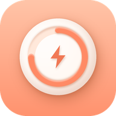

<p align="center">
  
</p>

<h1 align="center">Focus</h1>

<p align="center">
  A study planner and focus timer for students.<br>
  Plan tasks, run focus sessions, and see your progress, all on your phone and fully offline.
</p>

<p align="center">
  Flutter · Riverpod · Hive · Android
</p>

---

## Features

**Plans and tasks**
- Group tasks into plans, each with its own colour and default focus length.
- Tasks have a deadline, priority, subject, and an optional focus length of their own (5–180 min).
- Daily tasks reset every morning. Drag to reorder.
- Two starter plans: **Exam prep**, laid out backwards from your exam date, and **Daily routine**.

**Focus timer**
- Start, pause, resume, finish early or discard, then take an optional break.
- A mini bar stays above the navigation on every screen while a session runs.
- The timer is based on the wall clock, so it stays correct in the background and after the app is closed.
- Works in portrait and landscape.

**Android notification and widgets**
- A clay-styled notification with a live countdown and Pause / Resume / Stop buttons.
- Home-screen widgets:
  - **Focus timer (2×2):** the running timer with controls, or a Start button.
  - **Focus timer and up next (4×2):** the timer plus your next three tasks, each with a ▶ to start it.
- All buttons work without opening the app, even after it has been closed.

**Reminders** (scheduled on the device)
- Session complete, on time when exact alarms are allowed.
- Daily study reminders at times you choose.
- Deadline reminders a chosen time before each task is due.

**Progress**
- XP for focus time and finished tasks, levels, a daily streak and 11 badges.
- Stats for this week, the last 7 days, and focus time by plan and by subject.

**Themes**
- Six clay themes: Peach, Mint, Lavender, Sky, Midnight and Cocoa. The notification and widgets follow the theme you pick.

## Getting started

**Requirements**
- Flutter 3.32 or newer (developed on 3.47)
- Android SDK with platform 37 installed
- JDK 17

```bash
flutter pub get
flutter run
```

The `android/` folder is part of the repository and already holds every permission, receiver and widget the app needs. No extra setup step is required.

## Building a release

A universal APK carries the Flutter engine for three CPU types, so it is about 51 MB. Each phone only needs one of them. Build per CPU type, or as an App Bundle, which Google Play splits per device for you:

```bash
# Separate APKs per CPU type (about 15–19 MB each)
flutter build apk --release --split-per-abi --obfuscate --split-debug-info=build/symbols

# App Bundle for Google Play
flutter build appbundle --release --obfuscate --split-debug-info=build/symbols
```

| Build | Size |
| --- | --- |
| Universal APK | 51.5 MB |
| `arm64-v8a` (most phones) | 17.3 MB |
| `armeabi-v7a` (older phones) | 14.7 MB |
| `x86_64` (emulators, Chromebooks) | 18.8 MB |

Keep `build/symbols` for each release: you need it to read obfuscated crash stack traces (`flutter symbolize`).

**Before publishing**
- Release builds are currently signed with the debug key. Set up a release keystore by following [Flutter's Android deployment guide](https://docs.flutter.dev/deployment/android#sign-the-app).
- Change `applicationId` in `android/app/build.gradle.kts` from `com.example.focus_app` to an ID you own. It cannot be changed after the first upload to Google Play.

## Testing

```bash
flutter test      # 139 tests
flutter analyze
```

| Suite | Covers |
| --- | --- |
| `timer_test.dart` | Wall-clock maths, pause/resume, finishing early, relaunch after the app is killed, breaks, per-task lengths |
| `reminders_test.dart` | Reminder planning, sync, the ongoing notification, notification and widget buttons, widget data |
| `plans_test.dart` | Plans, tasks, presets, reordering |
| `xp_rules_test.dart`, `stats_test.dart` | XP, levels, streaks, badges, statistics |
| `models_test.dart` | Hive adapters and data compatibility |
| `layout_test.dart` | The timer screen and every tab at five phone sizes, portrait and landscape, with no overflow |
| `widget_test.dart` | The clay design system |

Tests run against real Hive storage in a temporary folder, with a fake clock the tests move by hand.

## Project structure

```
lib/
  main.dart              opens storage, seeds presets, starts the app
  app.dart               shell: content navigator, mini bar, nav bar
  core/
    clock.dart           injectable clock
    storage/             Hive boxes and adapter helpers
    design/              clay theme, cards, buttons, inputs
  features/
    plans/               plans, tasks, presets
    focus/               timer, sessions, focus screen, mini bar,
                         notification and widget button handling
    progress/            XP, levels, streaks, badges
    stats/               statistics
    settings/            settings
    reminders/           reminder planning, sync, platform service
    home/                home screen

packages/clay_timer_notification/
  lib/                   Dart API for the notification and widgets
  android/               native layouts, clay drawing, widget providers

tool/make_icons.py       draws the app icon at every size
test/                    unit, layout and widget tests
```

Code under `data/` and `providers/` has no Flutter imports, so the logic tests run as plain Dart.

## How it works

**The timer.** A running timer is one stored record holding its planned end time. The time left is always `end − now`. The once-a-second ticker only refreshes the screen, so nothing is lost while the app is in the background. On launch, a timer whose end has passed is logged as a full session, credited to the moment it actually ended.

**Notifications and widgets.** `ReminderSync` is the one place that keeps the outside world in step with the app. Whenever tasks, settings or the timer change, it:
- reschedules reminders,
- updates the ongoing notification,
- sends the home-screen widgets a fresh snapshot.

The notification and widgets are drawn natively in the `clay_timer_notification` plugin. Android counts their countdowns down by itself, and each widget redraws on its own when a timer ends and at midnight.

**Buttons while the app is closed.** Notification and widget buttons arrive in a background isolate:
- If the app is running, the tap is passed to it.
- Otherwise the handler opens storage itself and runs the same timer code, so sessions are logged and reminders rescheduled either way.

**Storage.** The Hive adapters are hand-written, with the same byte layout as `hive_generator`. Fields are only ever appended, so older data always loads.

## XP rules

| Action | XP |
| --- | --- |
| Focus session | 2 per minute, +10 for completing a planned session of 10 minutes or more. Sessions under a minute are not logged. |
| Finished task | 20, +5 for medium or +10 for high priority, +5 if on time. Once per task, or once per day for daily tasks. |
| Levels | 100 XP to reach level 2, then each level costs 50 more than the last (100, 150, 200, …). |
| Streak | A day counts when you log a session or finish a task. |

## Customising

| To change | Where |
| --- | --- |
| Themes | Add a `ClayTheme` to `ClayThemes.all` in `lib/core/design/clay_theme.dart` |
| Badges | Append to `badgeCatalog` in `lib/features/progress/data/badges.dart` |
| XP values | `lib/features/progress/data/xp_rules.dart` |
| App icon | Edit `tool/make_icons.py`, then run `python tool/make_icons.py` (needs Pillow) |

## Platform support

Built and tested for **Android** (minimum Android 7.0, API 24). The web build runs the app itself, but has no notifications or widgets. iOS is not set up.
